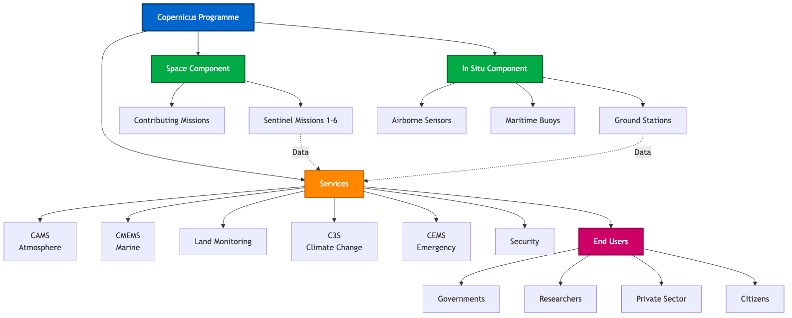
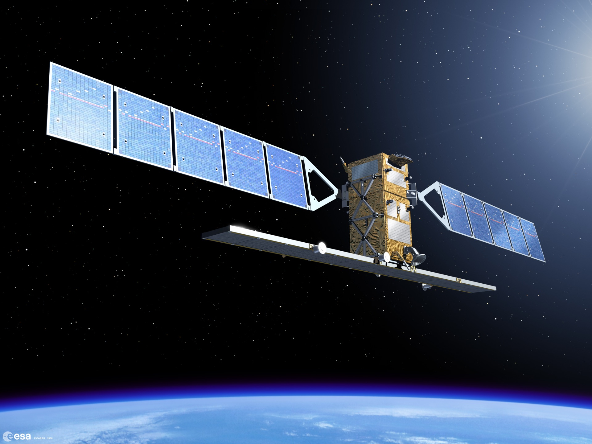
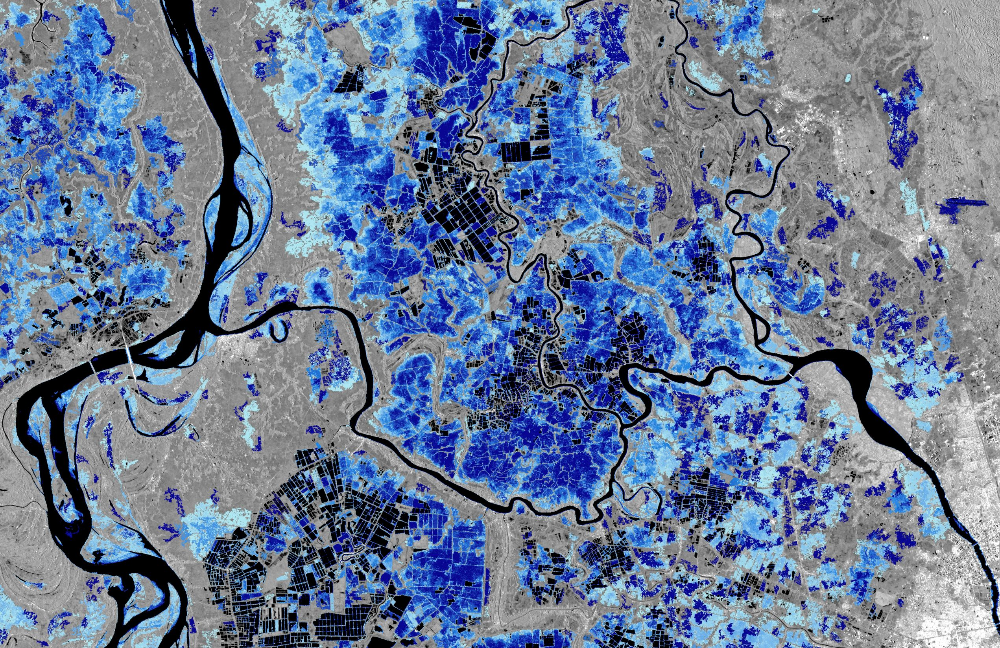
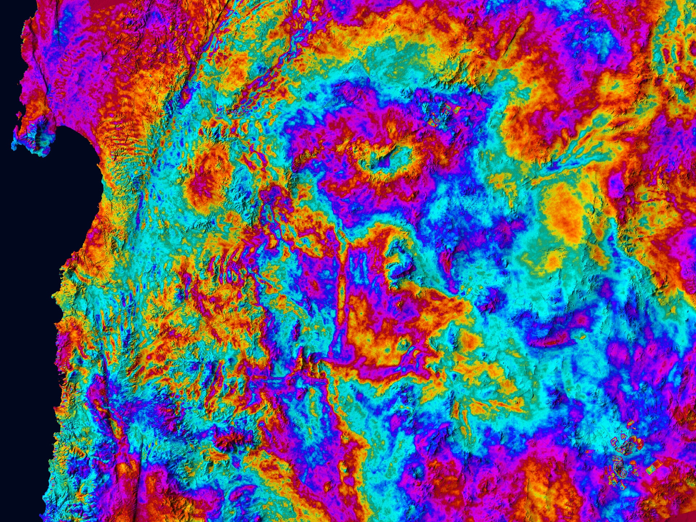
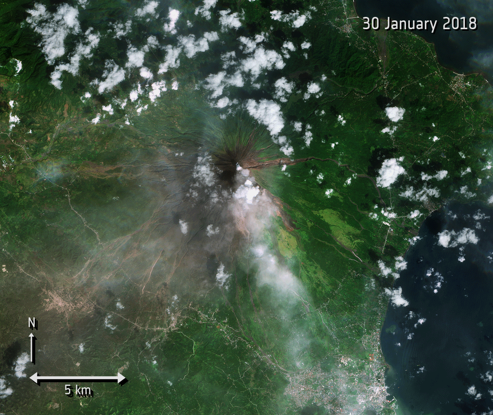
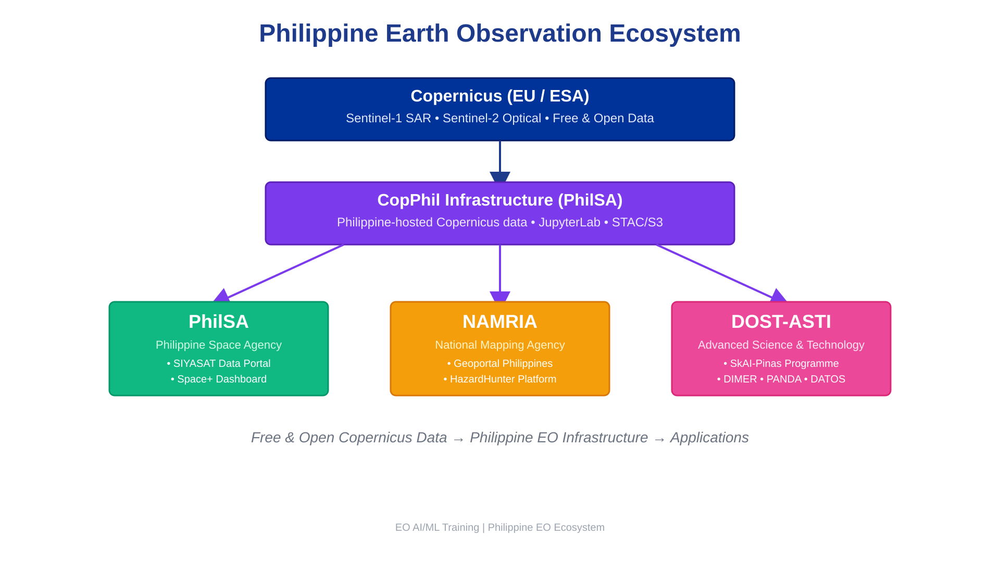

# Welcome {background-color="#1e3a8a"}

## Course Introduction

::: {.columns}
::: {.column width="50%"}
**4-Day Advanced Training**

- AI/ML for Earth Observation
- Philippine EO Professionals
- Focus: DRR, CCA, NRM
- Online format
:::

::: {.column width="50%"}
**Today's Goals**

- Understand Copernicus data
- Explore Philippine EO ecosystem
- Learn AI/ML fundamentals
- Hands-on Python and GEE
:::
:::

::: {.notes}
Welcome participants to the 4-day advanced training. Emphasize that the course provides practical skills for disaster risk reduction, climate change adaptation, and natural resource management.
:::

## Session 1 Roadmap

::: {.incremental}
1. Copernicus Programme Overview
2. Sentinel-1 Mission (SAR)
3. Sentinel-2 Mission (Optical)
4. Data Access Methods
5. Philippine EO Ecosystem
6. Philippine Copernicus Infrastructure (CopPhil)
:::

**Duration:** 2 hours

::: {.notes}
This session provides the foundation for understanding where EO data comes from and how Philippine agencies complement Copernicus data.
:::

# Part 1: The Copernicus Programme {background-color="#1e3a8a"}

## What is Copernicus?

**Europe's Eyes on Earth**

- EU flagship Earth Observation program
- Family of Sentinel satellites
- **Free and open data policy**
- Operational since 2014

::: {.fragment}
**"Looking at our planet and its environment for the benefit of all European citizens"**
:::

::: {.notes}
Copernicus is the European Union's Earth Observation program, providing free and open satellite data globally. It comprises a fleet of Sentinel satellites designed for environmental monitoring.
:::

---

## Copernicus Programme Architecture

{fig-align="center" width="90%"}

::: {.notes}
This diagram shows the complete Copernicus architecture: the space component with Sentinel missions, in-situ data sources, the six core services (CAMS, CMEMS, Land, Climate, Emergency, Security), and the various end-user categories.
:::

---

## The Sentinel Family

::: {.columns}
::: {.column width="50%"}
**Sentinel-1** (SAR)

- C-band radar imaging
- All-weather, day/night
- **1C (2024) + 1D (2025)** in operation
- 6-day repeat (two satellites)

**Sentinel-2** (Optical)

- Multispectral imaging
- 13 spectral bands
- **2B + 2C** in routine operation
- 5-day repeat (two satellites)
:::

::: {.column width="50%"}
**Sentinel-3** (Ocean/Land)

- Ocean and land monitoring
- Sea surface temperature
- Ocean color, vegetation

**Sentinel-5P** (Atmosphere)

- Air quality monitoring
- Atmospheric composition
:::
:::

::: {.notes}
**Timing:** 4 minutes

**Key Points:**
- Status as of November 2026: Sentinel-1, -2, -3, -5P and -6 operational; Sentinel-4 (geostationary, on MTG-S1, launched July 2025) and Sentinel-5 (on MetOp-SG-A1, launched August 2025) are the newest atmospheric missions; expansion missions (Sentinel-7 to -12) are in development
- Sentinel-1: 1C (launched Dec 2024) and 1D (launched Nov 2025, operational since spring 2026) restore the 6-day repeat; 1A ended operations on 30 June 2026 after 12 years; 1B failed in Dec 2021
- Sentinel-2: 2C replaced 2A in the reference constellation on 21 Jan 2025; 2A continues in an extension campaign (announced to run to end-2027), adding extra acquisitions
- Today we focus on Sentinel-1 and Sentinel-2 - most relevant for Philippine DRR/CCA/NRM
- Sentinel-3 important for marine/coastal applications
- Sentinel-5P monitors air pollution (useful for Manila air quality)

**Transition:**
"These missions generate petabytes of free data. Let's see how this data is used..."
:::

## Copernicus Applications

::: {.columns}
::: {.column width="50%"}
**Emergency Management**

- Flood mapping
- Fire detection
- Disaster response
:::

::: {.column width="50%"}
**Climate & Environment**

- Deforestation monitoring
- Agricultural monitoring
- Water quality assessment
:::
:::

::: {.notes}
Copernicus supports applications in emergency management, health care, agriculture, and environment, with crucial impact on society, climate, and economy.
:::

# Sentinel-1: SAR Mission {background-color="#0f766e"}

## Sentinel-1 Overview

::: {.columns}
::: {.column width="60%"}
**Mission Configuration (November 2026)**

- **Sensor:** C-band Synthetic Aperture Radar
- **Satellites:** **1C** (2024) and **1D** (2025); 1A retired June 2026
- **Orbit:** Polar sun-synchronous
- **All-weather, day/night capability**
:::

::: {.column width="40%"}
{width="100%"}
:::
:::

::: {.fragment}
**Key Advantage:** Penetrates clouds and works at night
:::

::: {.notes}
Sentinel-1 is a radar imaging mission with C-band SAR enabling all-weather, day-and-night observations unaffected by clouds - crucial in tropical regions like the Philippines.
:::

## Sentinel-1 Technical Specifications

| **Parameter** | **Value** |
|--------------|-----------|
| **Sensor Type** | C-band SAR (5.405 GHz) |
| **Revisit Time** | 6-12 days (constellation) |
| **Swath Width** | 250 km (IW mode) |
| **Spatial Resolution** | 5m × 20m (IW mode) |
| **Polarization** | VV + VH or HH + HV |
| **Orbit** | 693 km altitude |

::: {.notes}
Sentinel-1 operates in Interferometric Wide (IW) mode with ~5m by 20m spatial resolution. With two satellites, the revisit cycle is 6 days globally. History: Sentinel-1B failed in December 2021, leaving 1A alone (12-day repeat) until Sentinel-1C joined in 2025; Sentinel-1D became operational in spring 2026 and 1A was retired on 30 June 2026.
:::

## SAR: How It Works

::: {.incremental}
1. Satellite sends **microwave pulses** to Earth
2. Signal **reflects** from surface
3. Sensor measures **backscatter intensity**
4. Different surfaces = different backscatter
:::

::: {.notes}
SAR satellites send microwave signals and measure the backscatter. Water appears dark (low backscatter), urban areas appear bright (strong backscatter), and vegetation shows moderate backscatter.
:::

## Sentinel-1 Polarization

::: {.columns}
::: {.column width="50%"}
**What is Polarization?**

- Orientation of radar wave
- VV: Vertical send/receive
- VH: Vertical send/Horizontal receive
- HH: Horizontal send/receive
:::

::: {.column width="50%"}
**Applications**

- **VV:** Good for water/flood mapping
- **VH:** Sensitive to volume scattering (vegetation)
- **VV/VH Ratio:** Discriminates surface types
:::
:::

::: {.notes}
Sentinel-1 IW mode over land typically provides VV and VH polarizations. Different polarizations are sensitive to different surface characteristics.
:::

## Backscatter Characteristics by Target

| **Surface Type** | **Backscatter** | **Appearance** | **Reason** |
|------------------|----------------|----------------|------------|
| **Water (smooth)** | Very Low | Dark/Black | Specular reflection |
| **Urban/Buildings** | Very High | Bright White | Corner reflectors |
| **Forest/Vegetation** | Medium-High | Gray | Volume scattering |
| **Agricultural Fields** | Medium | Light Gray | Surface roughness |
| **Bare Soil (dry)** | Low-Medium | Dark Gray | Smooth surface |
| **Bare Soil (wet)** | Medium | Medium Gray | Increased dielectric |

::: {.fragment}
**Key Insight:** Water appears dark, structures appear bright - the basis for flood mapping!
:::

::: {.notes}
Understanding backscatter is crucial for interpreting SAR imagery. Smooth surfaces (water) reflect signals away = dark. Rough surfaces and structures reflect signals back = bright.
:::

## Sentinel-1 Imaging Modes

::: {.columns}
::: {.column width="50%"}
**Interferometric Wide Swath (IW)**
- **250 km swath**
- 5m × 20m resolution
- **Default over land**
- Philippine standard mode

**Extra Wide Swath (EW)**
- 400 km swath
- 20m × 40m resolution
- Maritime/polar regions
:::

::: {.column width="50%"}
**Strip Map (SM)**
- 80 km swath
- 5m × 5m resolution
- Emergency response
- High detail needed

**Wave (WV)**
- Ocean waves
- Not used for land
:::
:::

::: {.notes}
Interferometric Wide (IW) mode is used over land and provides the best balance of resolution and coverage. All Philippine acquisitions use IW mode.
:::

## Sentinel-1 Data Products

::: {.columns}
::: {.column width="50%"}
**Level-1 GRD (Ground Range Detected)**

- Multi-looked (reduced speckle)
- Projected to ground range
- **Most commonly used**
- Faster to process
- Smaller file size
- **Applications:**
  - Change detection
  - Classification
  - Flood mapping
  - Ship detection
:::

::: {.column width="50%"}
**Level-1 SLC (Single Look Complex)**

- Preserves phase information
- Complex-valued pixels
- Required for InSAR
- Larger files
- **Applications:**
  - Ground deformation
  - Interferometry
  - Coherence analysis
  - Subsidence monitoring
:::
:::

::: {.notes}
For most applications including flood mapping and land cover, GRD products are sufficient. SLC products are needed for advanced interferometric applications like volcano monitoring.
:::

## GRD vs SLC - Which to Choose?

| **Factor** | **GRD** | **SLC** |
|-----------|---------|---------|
| **Use Case** | Most applications | Interferometry only |
| **Processing** | Ready to use | Complex processing |
| **File Size** | ~1 GB | ~4 GB |
| **Speckle** | Reduced | Full speckle |
| **Phase** | Not preserved | Preserved |
| **Typical User** | Most analysts | Advanced specialists |

::: {.fragment}
**For this training and most Philippine applications: Use GRD**
:::

::: {.notes}
Unless you specifically need interferometry (earthquake/volcano deformation), always use GRD products. They're easier to work with and sufficient for 90% of applications.
:::

---

## Sentinel-1 Pre-Processing "Under the Hood" {background-color="#1e40af"}

::: {.callout-note}
## What Happens Before You See SAR Data?

For this training, we use **pre-processed Sentinel-1 GRD data**. Here's what happens "under the hood":
:::

**S1 Processing Pipeline:**

1. **GRD Download** → Raw ground-range detected amplitude
2. **Radiometric Calibration** → Convert to backscatter coefficient (σ⁰)
3. **Terrain Correction (RTC)** → Remove topographic distortions using DEM
4. **Speckle Filtering** → Reduce SAR noise (Lee, Refined Lee, or Gamma-MAP filters)
5. **Conversion to dB** → γ⁰ (gamma-naught) in decibels for visual interpretation
6. **Tiling/Clipping** → Extract area of interest

::: {.fragment}
**For Day 3 flood mapping labs:** We provide analysis-ready patches with these steps already applied
:::

::: {.notes}
**Key Teaching Points:**
- Participants need to understand what "analysis-ready" means
- RTC removes terrain effects - critical in mountainous Philippines
- Gamma-naught (γ⁰) in dB is standard for land applications
- Speckle filtering is essential but can blur edges
- These steps are computationally intensive - we pre-process for efficiency

**Timing:** 3 minutes

**Transition:** "Now let's look at Sentinel-2 optical data..."
:::

## Sentinel-1 Applications

::: {.columns}
::: {.column width="50%"}
**Flood Mapping**

{width="100%" height="350px" style="object-fit: contain;"}

- Water appears dark in SAR
- Works through clouds
- Near real-time monitoring
:::

::: {.column width="50%"}
**Deformation Monitoring**

{width="100%" height="350px" style="object-fit: contain;"}

- InSAR technique
- Millimeter precision
- Volcano and earthquake monitoring
:::
:::

::: {.notes}
Sentinel-1's ability to penetrate clouds makes it invaluable for flood mapping during typhoons. The left image shows actual flood monitoring using Sentinel-1 data. The right image shows an interferogram from Sentinel-1C demonstrating ground deformation detection with millimeter precision in northern Chile.
:::

## Philippine Example: Flood Monitoring

::: {.columns}
::: {.column width="50%"}
**November 2020: Typhoon Ulysses**

- Extensive flooding in Luzon
- Sentinel-1 detected flood extent
- Rapid mapping capability
:::

::: {.column width="50%"}
**Key Benefits**

- No cloud interference
- Quick response time
- Used for rapid damage assessment
- Supported emergency response
:::
:::

::: {.notes}
During Typhoon Ulysses, Sentinel-1 provided crucial flood extent mapping when optical satellites couldn't see through clouds. This data supported PAGASA and NDRRMC response efforts.
:::

---

# Sentinel-2: Optical Mission {background-color="#0f766e"}

## Sentinel-2 Overview

::: {.columns}
::: {.column width="50%"}
**Key Specifications:**

::: {.incremental}
- **13 spectral bands** (visible, NIR, SWIR)
- **10m to 60m** spatial resolution
- **290 km swath** width
- **5-day revisit** (2B + 2C constellation)
- **L1C & L2A** processing levels
:::
:::

::: {.column width="50%"}
**Philippine Example: Mayon Volcano**

{fig-align="center" width="100%"}

**Sentinel-2 monitoring of 2018 eruption**

- False-color composite highlighting lava flows
- 10m resolution captures detail
- 5-day revisit enables continuous monitoring
:::
:::

::: {.notes}
This Sentinel-2 false-color image of Mayon Volcano from 2018 shows recent lava flows. Sentinel-2B and 2C provide the 5-day global revisit; Sentinel-2A adds extra acquisitions during its extension campaign.
:::

## Sentinel-2 Spectral Bands

::: {style="font-size: 0.8em;"}
| **Band** | **Name** | **Wavelength (nm)** | **Resolution** | **Purpose** |
|----------|----------|---------------------|----------------|-------------|
| **B1** | Coastal Aerosol | 443 | 60m | Aerosol correction, water color |
| **B2** | Blue | 490 | **10m** | Water bodies, atmospheric |
| **B3** | Green | 560 | **10m** | Vegetation health |
| **B4** | Red | 665 | **10m** | Vegetation discrimination |
| **B5** | Red Edge 1 | 705 | 20m | Vegetation stress detection |
| **B6** | Red Edge 2 | 740 | 20m | Vegetation classification |
| **B7** | Red Edge 3 | 783 | 20m | Vegetation stress, chlorophyll |
| **B8** | NIR | 842 | **10m** | Biomass, water bodies |
| **B8A** | NIR Narrow | 865 | 20m | Atmospheric correction |
| **B9** | Water Vapor | 945 | 60m | Atmospheric correction |
| **B10** | SWIR Cirrus | 1375 | 60m | Cirrus cloud detection |
| **B11** | SWIR 1 | 1610 | 20m | Moisture content, fire |
| **B12** | SWIR 2 | 2190 | 20m | Moisture, geology, soil |
:::

::: {.notes}
**All 13 Sentinel-2 bands:** Four 10m bands (B2-B4, B8) for detailed mapping, six 20m bands including the unique Red Edge trio (B5-B7) for vegetation analysis, and three 60m atmospheric bands (B1, B9, B10) for corrections. The Red Edge bands are Sentinel-2's signature capability.
:::

## Red Edge Bands - Sentinel-2's Special Capability

::: {.columns}
::: {.column width="50%"}
**What is Red Edge?**

- Transition zone between red and NIR (700-780nm)
- **Three dedicated bands (B5, B6, B7)**
- Sensitive to chlorophyll content
- Rare among free high-resolution sensors

**Applications:**

- Early vegetation stress detection
- Crop health monitoring
- Forest disease identification
- Pre-harvest yield estimation
:::

::: {.column width="50%"}
**Philippine Use Cases:**

- **Rice crop assessment** - Monitor crop health and nitrogen status during panicle initiation in Nueva Ecija rice paddies
- **Coconut disease detection** - Identify stem bleeding disease and pest infestations through spectral signatures
- **Mangrove health monitoring** - Track vegetation stress and recovery in Palawan mangrove forests using red edge indices

::: {.fragment}
*Red edge bands detect stress weeks before visible bands show changes*
:::
:::
:::

::: {.notes}
Red Edge bands are Sentinel-2's superpower. They detect vegetation stress weeks before visible bands show changes - crucial for precision agriculture and forest health monitoring.
:::

## Sentinel-2 Data Products

::: {.columns}
::: {.column width="50%"}
**Level-1C (L1C)**

- Top-of-Atmosphere reflectance
- Radiometrically corrected
- Geometrically refined
- No atmospheric correction
- **Use:** If you need raw data for custom processing
:::

::: {.column width="50%"}
**Level-2A (L2A)**

- Bottom-of-Atmosphere (surface) reflectance
- Atmospherically corrected
- **Analysis-ready**
- Scene Classification Layer included
- **Use:** For most applications - RECOMMENDED
:::
:::

::: {.fragment}
**Always use Level-2A when available - it's analysis-ready!**
:::

::: {.notes}
L2A data is atmospherically corrected and ready for analysis. Unless you have a specific reason to use L1C, always choose L2A products.
:::

## Sentinel-2 Band Combinations

::: {.columns}
::: {.column width="50%"}
**True Color (Natural)**
- **RGB:** B4-B3-B2 (Red-Green-Blue)
- Looks like a photograph
- Good for visual inspection

**False Color Infrared**
- **RGB:** B8-B4-B3 (NIR-Red-Green)
- **Vegetation appears RED**
- Classic for vegetation assessment
:::

::: {.column width="50%"}
**SWIR Composite (Agriculture)**
- **RGB:** B11-B8-B2
- Highlights crop moisture
- Soil moisture visible

**SWIR-NIR-Red (Burn/Fire)**
- **RGB:** B12-B8-B4
- **Active fires appear BRIGHT**
- Burn scars dark purple
:::
:::

::: {.notes}
Different band combinations highlight different features. False Color (NIR-Red-Green) is the most common for vegetation mapping - healthy vegetation appears bright red.
:::

---

# Sentinel-1 vs Sentinel-2 {background-color="#0f766e"}

## Complementary Capabilities

| **Aspect** | **Sentinel-1** | **Sentinel-2** |
|------------|----------------|----------------|
| **Sensor Type** | Radar (SAR) | Optical (MSI) |
| **Weather** | All-weather | Cloud-affected |
| **Time** | Day & night | Daytime only |
| **Resolution** | 5m × 20m | 10m / 20m / 60m |
| **Revisit** | 6-12 days | 5 days |
| **Bands** | Polarizations (2) | Spectral bands (13) |
| **Best For** | Water, structure, moisture | Vegetation, land cover, color |

::: {.callout-tip}
## S1 Flood Mapping Tip

**VV polarization shows dark water** (low backscatter from smooth surfaces)

**Best practice:** Compare **pre-event vs post-event** delta for reliability

**Synergy:** Pair S1 (flood extent through clouds) with S2 (vegetation damage when clear) for complete impact assessment
:::

::: {.notes}
Sentinel-1 and Sentinel-2 are complementary. SAR penetrates clouds and works at night, while optical provides rich spectral information about surface properties.
:::

## Synergistic Use Cases

::: {.columns}
::: {.column width="50%"}
**Flood Mapping**

- **S1:** Detect water extent (through clouds)
- **S2:** Assess damage to vegetation/crops (when clear)
- **Combined:** Complete flood impact assessment
:::

::: {.column width="50%"}
**Forest Monitoring**

- **S1:** Detect structural changes, biomass
- **S2:** Identify tree species, health
- **Combined:** Comprehensive forest mapping
:::
:::

::: {.notes}
Using both missions together provides more complete information. After a typhoon, S1 maps floods under clouds while S2 assesses vegetation damage where it's clear.
:::

---

## ☕ 5-Minute Break {background-color="#7c3aed"}

::: {.r-fit-text}
**Stretch Break**

Stand up • Grab water • Back in 5 minutes
:::

::: {.notes}
**Timing:** 5 minutes

**Instructor Actions:**
- Announce break clearly
- Mention return time
- Leave slides/browser open for questions
- Be available for quick questions during break

**When Resuming:**
- Wait 1-2 minutes for everyone to return
- Quick recap: "We've covered Sentinel-1 SAR and Sentinel-2 optical. Now we'll explore the Philippine EO ecosystem."
:::

---

# Data Access Methods {background-color="#0f766e"}

## Platform Choices for This Training {background-color="#1e40af"}

::: {.callout-important}
## Which Platform for Which Task?

Understanding where to work is crucial - don't try to train deep models on GEE or download 100GB in Colab!
:::

| **Task** | **Platform** | **Why** | **Limitations** |
|----------|-------------|---------|-----------------|
| **Data Prep & Exploration** | **Google Earth Engine** | Petabyte catalog, no download, cloud composites | Small direct-download limit (use Export tasks); monthly compute quota; no deep learning training |
| **ML Training (RF, shallow)** | **GEE or Colab** | RF works in GEE; small data in Colab | GEE memory limits; Colab free tier quotas |
| **Deep Learning (CNN, U-Net)** | **Local GPU / Colab Pro** | Requires PyTorch/TensorFlow | Colab free = limited GPU time; large models need local resources |
| **Large-Scale Processing** | **CopPhil Infrastructure / COARE** | Philippine-hosted Sentinel data + JupyterLab; HPC (COARE) | Requires registration; learning curve for APIs |
| **Quick Viz & Download** | **Copernicus Browser** | Interactive, fast previews | Manual selection; bulk downloads tedious |

::: {.fragment}
**Quotas/Pitfalls to know:**
- GEE: Memory errors with large computations (tile exports!); noncommercial projects have a monthly EECU-hour quota
- Colab Free: GPU disconnects after inactivity; limited sessions/day
- **CopPhil Digital Campus**: free EO courses and materials from past Philippine Copernicus trainings
:::

::: {.notes}
**Key Teaching Points:**
- GEE is NOT for training U-Nets or downloading GBs
- Colab free tier has GPU quotas - manage expectations
- CopPhil Infrastructure offers Philippine-hosted data and a JupyterLab environment
- Choose the right tool for the right job

**Timing:** 3 minutes

**Transition:** "Let's look at these platforms in detail..."
:::

---

## Copernicus Data Space Ecosystem

::: {.columns}
::: {.column width="50%"}
**New Platform (2023+)**

- Replaced SciHub
- Modern interface
- API access
- Free registration
:::

::: {.column width="50%"}
**Features**

- Search by location/date
- Preview before download
- Direct download
- Bulk processing
:::
:::

**URL:** <https://dataspace.copernicus.eu>

::: {.notes}
The Copernicus Data Space Ecosystem is the new portal replacing the legacy SciHub. All Sentinel data are free and open.
:::

## SentiBoard Operations Dashboard

::: {.incremental}
- **Real-time mission status**
- Data availability insights
- Acquisition plans
- Quality metrics
- Interactive dashboard
:::

**URL:** <https://operations.dashboard.copernicus.eu>

::: {.notes}
SentiBoard is ESA's Copernicus Sentinel Operations Dashboard: mission status, acquisition plans and data availability in one place.
:::

## Google Earth Engine

::: {.columns}
::: {.column width="60%"}
**Planetary-Scale Platform**

- Petabyte-scale data catalog
- All Sentinel-1 & Sentinel-2 data
- Cloud-based processing
- Free for registered noncommercial Cloud projects (monthly compute quota)
- **No download needed!**
:::

::: {.column width="40%"}
{width="100%"}
:::
:::

::: {.fragment}
**We'll use GEE extensively in this training**
:::

**URL:** <https://earthengine.google.com>

::: {.notes}
Google Earth Engine provides ready access to all Sentinel data with cloud-based processing. We'll use GEE extensively for data access and preprocessing.
:::

## Alternative Data Sources

::: {.columns}
::: {.column width="50%"}
**Alaska Satellite Facility (ASF)**

- Sentinel-1 specialist
- User-friendly interface
- Preprocessing tools
- <https://asf.alaska.edu>
:::

::: {.column width="50%"}
**AWS Open Data**

- Sentinel-2 on AWS
- Cloud-optimized
- Pay for compute only
- Programmatic access
:::
:::

::: {.fragment}
**In the Philippines:** the CopPhil Infrastructure (Copernicus mirror site) serves Sentinel data from local servers - see the end of this session
:::

::: {.notes}
Multiple platforms provide Sentinel data access. The CopPhil Infrastructure provides **local data access in the Philippines for faster downloads** - useful for reducing international bandwidth bottlenecks.

**Key Point:** focused on Philippine scenes; free registration (check the Knowledge Base for current access levels)
:::

# Part 2: Philippine EO Ecosystem {background-color="#1e3a8a"}

## Overview of Philippine EO Landscape

{fig-align="center" width="85%"}

::: {.incremental}
- **PhilSA:** Space data and operations
- **NAMRIA:** National mapping and geospatial data
- **DOST-ASTI:** AI and remote sensing R&D
- **PAGASA:** Climate and weather data
:::

::: {.notes}
Beyond European satellites, the Philippines has its own geospatial data platforms and agencies that provide crucial complementary data and support.
:::

# Philippine Space Agency (PhilSA) {background-color="#0f766e"}

## PhilSA: National Space Agency

**Established:** August 2019

**Mandate:**

- Central civilian space agency
- Promote space data use
- Build national capacity
- Support DRR, CCA, NRM
- Hosts the CopPhil Centre and its Copernicus data infrastructure

**Website:** <https://philsa.gov.ph>

::: {.notes}
PhilSA is the central civilian space agency established in 2019 (Republic Act 11363). It hosts the CopPhil Centre and the Philippine Copernicus data infrastructure.
:::

## SIYASAT Data Portal

::: {.columns}
::: {.column width="50%"}
**Purpose**

- Secure data archive **operational**
- Visualization system
- Data distribution
- Maritime & terrestrial monitoring
:::

::: {.column width="50%"}
**Data Types**

- NovaSAR-1 radar imagery
- AIS ship tracking data
- Processed products
- Analysis-ready data
:::
:::

::: {.notes}
**Timing:** 3 minutes

**Key Points:**
- SIYASAT is the portal of the SAR with AIS (SARwAIS) project, which secured a share of NovaSAR-1 (S-band SAR + AIS) tasking for the Philippines
- Provides a secure archive, visualization and distribution system for radar images and AIS data
- Provides secure archive for Philippine government agencies
- Critical for maritime security (illegal fishing, territorial monitoring)
- Registration required - priority for government agencies

**Transition:**
"Beyond PhilSA, DOST-ASTI is leading AI innovation for EO applications..."
:::

## Space+ Data Dashboard

::: {.incremental}
- **User-friendly web portal**
- Browse satellite imagery
- Visualization tools
- Download datasets
- **No programming required**
- Open to government, researchers, public
:::

::: {.notes}
The Space+ Data Dashboard democratizes access to satellite data, making it available to local governments, researchers, and even students without requiring programming skills.
:::

## PhilSA Initiatives (2025 snapshot)

::: {.columns}
::: {.column width="50%"}
**Space Business Innovation Challenge**

- Empowers Filipino innovators
- Free satellite data access
- Build solutions for local needs
- Earth observation focus
- Weather & environmental data
:::

::: {.column width="50%"}
**Training Programs**

- Downstream data utilization
- Practical applications
- Capacity building nationwide
- Partnership with DOST
:::
:::

::: {.notes}
PhilSA's 2025 initiatives focus on empowering innovators and building capacity across the Philippines to use satellite data effectively.
:::

## COARE Infrastructure (DOST-ASTI)

**Computing and Archiving Research Environment**

- High-performance computing
- Data archiving capabilities
- Science cloud facilities
- Supports data-intensive research
- Enables AI/ML workflows

::: {.notes}
COARE, operated by DOST-ASTI, provides the computational infrastructure needed for processing large satellite datasets and running AI/ML models at scale.
:::

# NAMRIA {background-color="#0f766e"}

## NAMRIA: National Mapping Authority

::: {.columns}
::: {.column width="60%"}
**National Mapping and Resource Information Authority**

**Role:**

- Official mapping agency
- Authoritative geospatial data
- Topographic maps
- Hazard maps
- Land cover datasets
:::

::: {.column width="40%"}
**Typical uses in this course**

- Administrative boundaries
- Reference land cover for validation
- Hazard context layers
:::
:::

**Website:** <https://www.geoportal.gov.ph>

::: {.notes}
NAMRIA is the national mapping agency responsible for topographic maps, hydrographic data, and authoritative geospatial datasets.
:::

## NAMRIA Geoportal

**One-Stop Shop for Philippine Geospatial Data**

::: {.incremental}
- National basemaps (1:50,000 scale)
- Administrative boundaries
- Topographic maps
- Thematic maps
- **Downloadable shapefiles and rasters**
:::

::: {.notes}
The NAMRIA Geoportal is the go-to source for official Philippine spatial data including boundaries, topographic maps, and land cover data.
:::

## Land Cover Mapping Project

::: {.columns}
::: {.column width="50%"}
**Latest:** 2020 National Land Cover

**Classes:**

- Forest types
- Agriculture
- Built-up areas
- Water bodies
- Wetlands
- Barren land
:::

::: {.column width="50%"}
**Data Formats:**

- Shapefile
- GeoTIFF
- CSV
- GeoJSON
- KML
- PNG
:::
:::

**Portal:** <https://land-cover-mapping-project-namria.hub.arcgis.com>

::: {.notes}
NAMRIA's land cover datasets are valuable for validation and comparison with satellite-derived classifications. The 2020 national land cover map is available in multiple formats.
:::

## HazardHunterPH Portal

**Comprehensive Hazard Assessment Platform**

::: {.columns}
::: {.column width="50%"}
**Hazard Types:**

- Earthquake-induced hazards
- Active fault lines
- Tsunami susceptibility
- Liquefaction zones
- Landslide hazards
:::

::: {.column width="50%"}
**Applications:**

- Disaster risk assessment
- Land use planning
- Infrastructure siting
- Emergency preparedness
:::
:::

**URL:** <https://hazardhunter.georisk.gov.ph/map>

::: {.notes}
HazardHunterPH provides critical hazard data for DRR planning. These maps can be overlaid with satellite data for vulnerability assessments.
:::

## How NAMRIA Complements Sentinel Data

::: {.columns}
::: {.column width="50%"}
**Sentinel Imagery Provides:**

- Current conditions
- Frequent updates
- Large-area coverage
- Multi-temporal analysis
:::

::: {.column width="50%"}
**NAMRIA Data Provides:**

- **Ground truth for validation**
- **Training labels for ML models**
- Historical baselines
- Official classifications
- Hazard context
:::
:::

::: {.callout-tip}
## Using NAMRIA/Space+ as Label Sources

**For Day 2 Palawan RF lab:**
1. Download NAMRIA land cover shapefile (authoritative classes)
2. Overlay on Sentinel-2 imagery
3. Extract training points per class (forest, agriculture, water, etc.)
4. Train Random Forest classifier
5. Validate predictions against NAMRIA hold-out samples

**Space+ Dashboard** also provides admin boundaries and infrastructure layers for context in all visualizations.
:::

::: {.fragment}
**Example:** Use Sentinel-2 to map current land cover, validate against NAMRIA's official 2020 map, detect changes
:::

::: {.notes}
Emphasise NAMRIA/Space+ as **label sources & validation layers**, not just context.

NAMRIA data provides essential ground truth and context for satellite-based analysis. Official boundaries and hazard maps enhance satellite data interpretation.

**Show one example overlay:** NAMRIA training polygons (land cover classes) overlaid on S2 RGB composite.
:::

# DOST-ASTI AI Initiatives {background-color="#0f766e"}

## DOST-ASTI Overview

::: {.columns}
::: {.column width="60%"}
**Advanced Science and Technology Institute**

- Lead agency for EO and AI R&D
- Remote sensing expertise
- Machine learning development
- National AI infrastructure
- **P2.6 billion investment until 2028**
:::

::: {.column width="40%"}
**Platforms covered next**

- DATOS, SkAI-Pinas
- DIMER, AIPI, ALaM
- COARE (computing)
:::
:::

**Website:** <https://asti.dost.gov.ph>

::: {.notes}
DOST-ASTI leads several projects at the intersection of remote sensing, AI, and big data, with significant national investment of P2.6 billion through 2028.
:::

## DATOS: Remote Sensing Help Desk

::: {.incremental}
- **Remote Sensing and Data Science Help Desk**
- Rapid analytics during disasters
- Flood mapping from satellite imagery
- Damage assessment
- Crop mapping (rice, sugarcane)
- Road network detection
- Supports emergency response agencies
:::

::: {.notes}
During past typhoons, DATOS used satellite images to produce flood maps and give them to disaster response agencies within hours. They also worked on crop mapping and infrastructure detection using AI.
:::

## SkAI-Pinas Programme

::: {.columns}
::: {.column width="50%"}
**Philippine Sky AI Program (2021-2028)**

- Flagship AI R&D programme
- **Part of P2.6B DOST AI investment**
- Democratize AI across Philippines
- Remote sensing & big data focus
:::

::: {.column width="50%"}
**Reported reach (2025)**

- 300+ institutions supported
- Universities & colleges
- SMEs & research teams
- Local government units
:::
:::

::: {.notes}
**Timing:** 3 minutes

**Key Points:**
- SkAI-Pinas is part of DOST's P2.6 billion AI investment (2024-2028)
- Focuses on democratizing AI for EO applications
- Provides infrastructure, training, and support
- Successfully engaged 300+ institutions nationwide
- Critical for building national AI capacity

**Examples:**
- Universities using SkAI for flood mapping research
- LGUs leveraging AI for disaster preparedness
- SMEs building EO-based agricultural solutions

**Transition:**
"SkAI provides the platform. DIMER provides the models..."
:::

## DIMER: AI Model Hub

::: {.columns}
::: {.column width="50%"}
**Democratized Intelligent Model Exchange Repository**

- Digital "model store"
- Pre-trained AI models
- Ready-to-use
- Filipino-specific challenges
:::

::: {.column width="50%"}
**Available Models**

- Landslide detection
- Traffic surveys
- Crop monitoring
- Land cover classification
- Flood detection
:::
:::

::: {.notes}
DIMER lowers barriers to AI by enabling end-users to reuse optimized AI models. If you need a model for land cover or flood detection, check DIMER first before building from scratch.
:::

## AIPI: AI Processing Interface

**Purpose**

- Streamline large-scale remote sensing tasks
- Reduce computational barriers
- Run AI models on ASTI servers
- Process hundreds of images efficiently

::: {.fragment}
**Example:** Apply an AI model to 100 Sentinel-2 images over entire region without your laptop
:::

::: {.notes}
AIPI allows users to run large computations on ASTI's servers without heavy local processing. This is especially valuable when processing many satellite images with AI models.
:::

## ALaM: Automated Labeling Machine

::: {.columns}
::: {.column width="50%"}
**Challenge**

Creating labeled training data is:

- Time-consuming
- Expensive
- Requires expertise
- Major bottleneck for AI
:::

::: {.column width="50%"}
**ALaM Solution**

- Automate labeling process
- Crowdsourcing capabilities
- Expert validation
- Build training datasets
:::
:::

::: {.fragment}
**Result:** Faster creation of high-quality training data for Filipino contexts
:::

::: {.notes}
Creating labeled data is a big challenge in EO AI. ALaM tries to address this through automation and crowdsourcing, making it easier to build training datasets for Philippine applications.
:::

## How DOST-ASTI Tools Work Together

::: {.incremental}
1. **ALaM** creates training data
2. Train models and share via **DIMER**
3. Process large datasets with **AIPI**
4. Deploy for operational use via **SkAI-Pinas**
5. Support disaster response through **DATOS**
:::

::: {.notes}
These initiatives work together to create a complete ecosystem from data labeling through model development to operational deployment.
:::

# PAGASA & Other Data Sources {background-color="#0f766e"}

## PAGASA: Weather & Climate Data

::: {.columns}
::: {.column width="60%"}
**Philippine Atmospheric, Geophysical and Astronomical Services Administration**

**Data Types:**

- Historical rainfall
- Temperature records
- Typhoon tracks
- Climate forecasts
- Weather observations
:::

::: {.column width="40%"}
**Where to find it**

- <https://www.pagasa.dost.gov.ph>
- PANaHON: <https://www.panahon.gov.ph>
:::
:::

::: {.fragment}
**Integration:** Combine with satellite data for climate analysis
:::

::: {.notes}
PAGASA provides meteorological and climate data that can be integrated with satellite observations for comprehensive analysis. Rainfall data + flood maps, for example.
:::

## Synergy: Satellite + Ground Data

::: {.columns}
::: {.column width="50%"}
**Satellite Data (Sentinel)**

- Spatial coverage
- Consistent acquisition
- Multiple variables
- Time series
:::

::: {.column width="50%"}
**Ground Data (Philippine agencies)**

- Point validation
- Ground truth
- Meteorological context
- Local expertise
:::
:::

::: {.fragment}
**Combined = More robust analysis and higher confidence**
:::

::: {.notes}
The Philippines is developing a rich EO ecosystem. The aim is to leverage both international (Sentinel) and national data together effectively.
:::

# Philippine Copernicus Infrastructure (CopPhil) {background-color="#1e3a8a"}

## CopPhil Infrastructure (Copernicus Mirror Site)

::: {.incremental}
- **Philippines-hosted copy of Copernicus Sentinel data**, updated daily
- Covers the Philippine land and sea area (>1.8 million km²)
- Hosted at PhilSA; cloud platform operated by CloudFerro
- **Data Explorer** (search & download), **JupyterLab**, STAC catalogue, S3 object-storage access, Knowledge Base
- Free registration: <https://application.infra.copphil.philsa.gov.ph>
:::

**Portal:** <https://infra.copphil.philsa.gov.ph> (online as of November 2026)

::: {.notes}
The CopPhil Infrastructure stores Sentinel data for the Philippines locally, which makes downloads much faster than from European servers. It also offers a hosted JupyterLab next to the data. Access levels and quotas change over time - point learners to the Knowledge Base (knowledgebase.infra.copphil.philsa.gov.ph) for the current registration rules.
:::

## CopPhil Digital Campus

::: {.columns}
::: {.column width="50%"}
**What it is**

- Online learning platform (Moodle)
- Self-paced EO courses
- Materials from past Philippine Copernicus training events
:::

::: {.column width="50%"}
**Typical content**

- Ground motion (InSAR)
- Land cover, forest and crop monitoring
- Coastal / benthic habitat mapping
:::
:::

**URL:** <https://courses.copphil.philsa.gov.ph>

::: {.notes}
The Digital Campus hosts separate courses that complement this one. This course's own materials are published openly at anefelo.github.io/eo-ai-ml-training.
:::

## Building a Sustainable EO Ecosystem

::: {.incremental}
1. **Data Access:** CopPhil Infrastructure + Copernicus Data Space Ecosystem
2. **Processing:** COARE + AIPI + Google Earth Engine
3. **Models:** DIMER repository
4. **Training:** CopPhil Digital Campus, EO College
5. **Operations:** DATOS + Agency integration
6. **Community:** SkAI-Pinas network
:::

::: {.fragment}
**Result:** Complete infrastructure for operational EO AI/ML**
:::

::: {.notes}
Together these platforms let you continue working with Sentinel data and AI/ML tools after this course, without starting from scratch.
:::

# Summary & Integration {background-color="#1e3a8a"}

## Key Takeaways

::: {.incremental}
1. **Copernicus** provides free, high-quality satellite data globally
2. **Sentinel-1** (SAR) works day/night, all-weather - essential for tropics
3. **Sentinel-2** (optical) provides rich spectral information - 5 day revisit
4. **Multiple access methods** available (Data Space, GEE, Mirror Site)
5. **Philippine agencies** provide complementary data and expertise
6. **CopPhil Infrastructure** gives Philippine-hosted access to Copernicus data
:::

::: {.notes}
You now understand the full picture from data sources through national infrastructure. This foundation supports all subsequent AI/ML work.
:::

## How It All Connects

::: {.incremental}
- **Satellite data:** Copernicus Sentinels, PhilSA missions
- **Ground truth:** NAMRIA maps, PAGASA observations, field data
- **AI models:** DIMER, SkAI-Pinas projects, your own models
- **Processing:** GEE, COARE, AIPI, CopPhil Infrastructure
- **Result:** operational DRR, CCA and NRM applications
:::

::: {.notes}
Satellite data + Philippine ground truth + AI models + processing infrastructure = Operational applications for DRR, CCA, and NRM
:::

## Example Workflow: Flood Mapping

::: {.incremental}
1. **Acquire** Sentinel-1 SAR data (GEE or Mirror Site)
2. **Validate** with PAGASA rainfall data
3. **Process** using AI model from DIMER
4. **Scale** processing via AIPI
5. **Combine** with NAMRIA hazard maps
6. **Deliver** to NDRRMC via DATOS
:::

::: {.fragment}
**This is what integrated EO capacity looks like!**
:::

::: {.notes}
A real-world workflow leverages multiple data sources, AI tools, and institutional partnerships.
:::

---

## What's Next in Day 1?

::: {.columns}
::: {.column width="50%"}
**Session 2 (Next)**

- AI/ML fundamentals
- Supervised vs unsupervised learning
- Neural networks basics
- Data-centric AI
- **→ 5-min Concept Check** (3 questions)
:::

::: {.column width="50%"}
**Sessions 3 & 4**

- Hands-on Python (GeoPandas, Rasterio)
  - **Pre-run pip installs** to save time
- Google Earth Engine tutorial
  - **Start from ready script**, modify filters only
- Access real Sentinel data
- **SCL cloud/shadow masking** (not QA60)
:::
:::

::: {.notes}
Now that you understand where data comes from, we'll learn how AI/ML can extract information from these data, then get hands-on with actual satellite imagery.

**Logistics for the hands-on sessions:**
- Concept check after Session 2
- Pre-run installations in Session 3
- Ready GEE script in Session 4 (modify filters live, don't type from scratch)
:::

## Session Summary

**What We Covered:**

::: {.incremental}
✅ Copernicus Programme & free/open data policy  
✅ Sentinel-1 (SAR) - all-weather monitoring  
✅ Sentinel-2 (Optical) - 13 bands, 10m resolution  
✅ **Constellation status (Nov 2026):** S1C + S1D; S2B + S2C (2A in extension)  
✅ Philippine EO infrastructure (PhilSA, NAMRIA, DOST-ASTI)  
✅ Data access platforms (SIYASAT, Geoportal, SkAI-Pinas)  
:::

::: {.notes}
**Timing:** 2 minutes

**Key Takeaways:**
- You now understand WHERE EO data comes from
- You know WHAT satellites provide what data
- You know HOW to access data (both EU and PH platforms)
- Ready for Session 2: Learning WHAT to do with this data using AI/ML
:::

---

## Q&A

::: {.columns}
::: {.column width="50%"}
**Copernicus & Sentinel**

- Mission specifications?
- Data products & formats?
- Access methods?
- Processing levels?
:::

::: {.column width="50%"}
**Philippine EO Ecosystem**

- Agency roles & mandates?
- Data access procedures?
- Integration with Copernicus?
- P2.6B AI investment details?
:::
:::

::: {.notes}
**Timing:** 3-5 minutes for Q&A

**Facilitation Tips:**
- Encourage questions from different agency participants
- Share knowledge across government, academic, private sectors
- If technical question about access, note for Session 4 (GEE hands-on)
- Keep responses brief - detailed hands-on coming in Sessions 3-4

**Common Questions & Answers:**
- "How do I sign up for GEE?" → Will cover in Session 4
- "Which satellite should I use?" → Depends on application (Day 2 topic)
- "Is SIYASAT public?" → Registration required, priority for gov agencies
- "Can I combine Sentinel-1 and -2?" → Yes! Synergistic use cases discussed today
:::

# Next: Session 2 {background-color="#0f766e"}

## Core Concepts of AI/ML for Earth Observation

**Coming up after break:**

- What is AI/ML and why for EO?
- The EO AI/ML workflow
- Supervised vs unsupervised learning
- Introduction to deep learning
- Data-centric AI approaches

::: {.fragment}
**See you in Session 2! 🚀**
:::

---

# Thank You! {background-color="#1e3a8a"}

## Contact & Resources

**European Platforms:**  
Copernicus Data Space: <https://dataspace.copernicus.eu>  
CopPhil Infrastructure: <https://infra.copphil.philsa.gov.ph>

**Philippine Platforms:**  
PhilSA: <https://philsa.gov.ph>  
NAMRIA Geoportal: <https://www.geoportal.gov.ph>  
DOST-ASTI: <https://asti.dost.gov.ph>

::: {.notes}
**Session 1 Complete!**

Total timing: ~120 minutes including breaks and Q&A

**Before Session 2:**
- Short bio break (5-10 minutes)
- Check that all participants are ready
- Ensure presentation materials for Session 2 are loaded
:::

---

**15-minute break before Session 2**
