## Lab Overview {.smaller}

::: {.columns}
::: {.column width="58%"}
**Duration:** 2.5 hours
**Type:** Hands-on Coding Lab
**Platform:** Google Colab with GPU

**You will:**

- Load and configure pre-trained object detectors
- Prepare Sentinel-2 imagery and COCO annotations
- Fine-tune detector on Metro Manila building dataset
- Evaluate with mAP, Precision, Recall metrics
- Visualize detections and export results for GIS
:::

::: {.column width="42%"}
**Prerequisites:**

- Session 3 (object detection theory)
- Google Colab account
- GPU runtime enabled
- Basic Python/PyTorch knowledge

**Resources:**

- Format: guided walkthrough (no dedicated notebook in this edition)
- Runnable references: torchvision detection tutorial, Ultralytics tutorial notebook (both on Colab)
- Practice data: `dota8.yaml` (8 aerial images, auto-download)
:::
:::

---

# Case Study: Metro Manila {background-color="#2C5F77"}

---

## Philippine Urban Monitoring Context

**Location:** Metro Manila - National Capital Region (NCR)
**Focus Areas:** Quezon City and Pasig River corridor
**Challenge:** Rapid informal settlement growth and urban sprawl

::: {.callout-note}
## Why This Matters

Metro Manila's rapid urbanization creates challenges for:

- **Disaster Risk Reduction** - Identifying vulnerable settlements in flood zones
- **Urban Planning** - Monitoring informal settlements and infrastructure
- **Population Estimation** - Building counts for demographic analysis
- **Resource Allocation** - Targeting social services and infrastructure
:::

---

## Data and Objectives

**Data Source:** Sentinel-2 Multispectral Imagery

- **Spatial Resolution:** 10m RGB bands (B4, B3, B2)
- **Temporal Coverage:** 5-day revisit for change detection
- **Additional Bands:** NIR (B8) for enhanced detection
- **Study Area:** Urban patches from Quezon City

**Lab Goal:**

Automate building detection using transfer learning to enable rapid, scalable urban monitoring

---

## The Challenge

::: {.columns}
::: {.column width="50%"}
### Manual Approach Problems

- Time-consuming digitization
- Inconsistent interpretation
- Cannot scale to city-wide mapping
- Difficult to update regularly
- Subjective delineation
:::

::: {.column width="50%"}
### Deep Learning Solution

- **Automated identification** from satellite imagery
- **Rapid mapping** of large areas in hours
- **Change detection** over time
- **Scalable monitoring** for metropolitan regions
- **Quantitative analysis** of urban patterns
:::
:::

---

# Lab Workflow {background-color="#2C5F77"}

---

## Transfer Learning Workflow

{width="100%"}

**7 Key Steps:**

1. Setup & load pre-trained model
2. Look at practice data (aerial images, COCO/YOLO labels)
3. Prepare data and annotations
4. Fine-tune detector (10-30 epochs)
5. Run inference on test images
6. Evaluate with mAP metrics
7. Visualize and export results

---

# Part 1: Transfer Learning Concepts {background-color="#2C5F77"}

---

## What is Transfer Learning?

**Definition:** Adapt a model pre-trained on a large dataset to your specific task with minimal additional training data

**Analogy:** Like a doctor specializing in cardiology after completing general medical training - the foundational knowledge transfers, requiring less time to specialize

---

## Transfer Learning for Object Detection

::: {.columns}
::: {.column width="50%"}
### Pre-trained Model Knows

- What makes objects distinct from background
- How to propose bounding boxes
- How to classify regions
- General visual features (edges, textures, shapes)

**Trained on:** COCO dataset (330K images, 80 classes)
:::

::: {.column width="50%"}
### We Adapt It For

- Detecting buildings in satellite imagery
- Understanding urban patterns
- Philippine-specific urban morphology
- Sentinel-2 spectral characteristics

**Fine-tune with:** 100-500 labeled satellite images
:::
:::

---

## Why Transfer Learning for Philippine EO?

### Challenge: Limited Labeled Data

::: {.incremental}
- Annotation is expensive (bounding boxes take time)
- Philippine-specific datasets are scarce
- Small agencies can't afford large labeling efforts
- Traditional approach: Need 10,000+ annotated images
:::

. . .

### Solution: Transfer Learning

::: {.incremental}
- Start with pre-trained model (free, publicly available)
- Fine-tune with **a few hundred** labelled images
- Useful accuracy far faster than from scratch (mAP depends on resolution & labels)
- Training time: **tens of minutes** on a Colab GPU (vs. days from scratch)
:::

---

## Model Options

| Model | Speed | Accuracy | Best For |
|-------|-------|----------|----------|
| **Faster R-CNN MobileNetV3-FPN** (torchvision) | Fast | Good | Colab-friendly fine-tuning |
| **Faster R-CNN ResNet-50-FPN v2** (torchvision) | Slow | Excellent | Offline analysis, small objects |
| **YOLO11 / YOLO26** (Ultralytics) | Fast | Very Good | Simple training API; OBB variants for aerial imagery |

::: {.callout-tip}
## Recommendation for Lab
**torchvision Faster R-CNN MobileNetV3** to see every step of the loop; **Ultralytics YOLO** for a one-call workflow.
:::

::: {.callout-warning}
## Resolution reality check
Sentinel-2 = 10 m pixels: most Metro Manila houses are 1–2 pixels. Individual buildings need ≲1 m imagery; at 10 m, map built-up areas/clusters (segmentation) or large objects (ships, large buildings).
:::

---

# Part 2: Data Preparation {background-color="#2C5F77"}

---

## Exercise 1: Load Pre-trained Model (20 min)

**Objective:** Load a COCO-pretrained object detector

```python
from torchvision.models.detection import (
    fasterrcnn_mobilenet_v3_large_fpn, FasterRCNN_MobileNet_V3_Large_FPN_Weights)
from torchvision.models.detection.faster_rcnn import FastRCNNPredictor

weights = FasterRCNN_MobileNet_V3_Large_FPN_Weights.DEFAULT  # not pretrained=True
model = fasterrcnn_mobilenet_v3_large_fpn(weights=weights)
in_features = model.roi_heads.box_predictor.cls_score.in_features
model.roi_heads.box_predictor = FastRCNNPredictor(in_features, num_classes=2)  # bg + building

# Ultralytics alternative: from ultralytics import YOLO; model = YOLO("yolo26n.pt")
```

**What You'll Learn:**

- How to load pre-trained models with the current weights API
- Understanding model input/output format
- Visualizing default detections (COCO classes)

---

## Exercise 2: Prepare Training Data (30 min)

**Objective:** Load and prepare satellite imagery with building annotations

**Data Format:**

::: {.columns}
::: {.column width="50%"}
**Images:**

- RGB patches (VHR for buildings; Sentinel-2 for large objects)
- Size: e.g. 512×512 pixels
- Format: PNG or GeoTIFF
- Normalized 0-1 range
:::

::: {.column width="50%"}
**Annotations:**

- COCO JSON format
- Bounding boxes: [x, y, width, height]
- Category: building (id=1)
- Includes image metadata
:::
:::

---

## COCO JSON Format Example

```json
{
  "images": [
    {"id": 1, "file_name": "metro_manila_001.png", "width": 512, "height": 512}
  ],
  "annotations": [
    {
      "id": 1,
      "image_id": 1,
      "category_id": 1,
      "bbox": [120, 150, 80, 60],
      "area": 4800,
      "iscrowd": 0
    }
  ],
  "categories": [
    {"id": 1, "name": "building", "supercategory": "structure"}
  ]
}
```

---

## Data Preparation Tasks

**Steps:**

1. **Load practice dataset** - e.g. `dota8.yaml` or your own COCO export
2. **Visual inspection** - View images with bounding boxes overlay
3. **Data split** - 70% train, 15% validation, 15% test
4. **Convert format** - Transform to model's expected input
5. **Data augmentation** (optional) - Rotation, flip, brightness

::: {.callout-note}
## Data for this walkthrough
No annotated Metro Manila dataset ships with the course. Practise on `dota8.yaml`, DOTA, xView or SpaceNet, or annotate your own tiles in CVAT / Label Studio (COCO export).
:::

---

# Part 3: Fine-Tuning {background-color="#2C5F77"}

---

## Exercise 3: Fine-tune Model (40 min)

**Objective:** Adapt the pre-trained detector to recognize buildings in satellite imagery

**Fine-tuning Strategy:**

::: {.incremental}
- **Freeze early layers** - Keep general feature extractors
- **Train detection head** - Adapt bounding box prediction
- **Small learning rate** - 0.0001 to 0.001 (avoid catastrophic forgetting)
- **Limited epochs** - 10-30 epochs typically sufficient
- **Early stopping** - Monitor validation loss
:::

---

## Fine-Tuning Code Structure

```python
# torchvision: images = list of [3,H,W] tensors in [0,1];
# targets = list of {"boxes": [N,4] xyxy, "labels": [N]}
for p in model.backbone.parameters():
    p.requires_grad = False                      # freeze backbone
params = [p for p in model.parameters() if p.requires_grad]
optimizer = torch.optim.SGD(params, lr=0.005, momentum=0.9, weight_decay=5e-4)

for epoch in range(20):
    model.train()
    for images, targets in train_loader:
        loss_dict = model(images, targets)       # cls, box-reg, objectness, rpn-box
        loss = sum(loss_dict.values())
        optimizer.zero_grad(); loss.backward(); optimizer.step()
    print(f"Epoch {epoch}: loss={loss.item():.4f}")

# Ultralytics (oriented boxes, aerial): YOLO("yolo26n-obb.pt").train(data="dota8.yaml", epochs=20, imgsz=640)
```

---

## What You'll Observe

**Training Progress:**

::: {.incremental}
- Training loss decreases steadily over epochs
- Validation loss decreases then plateaus (convergence)
- Typical training time: **tens of minutes** on a Colab GPU for a few hundred images
- Without GPU: many times slower (use a tiny dataset such as `dota8`)
:::

. . .

**Signs of Good Training:**

- Train and validation loss both decrease
- Small gap between train and val loss
- Validation loss stabilizes (not increasing)

---

# Part 4: Evaluation {background-color="#2C5F77"}

---

## Exercise 4: Evaluate with mAP (25 min)

**Objective:** Calculate mean Average Precision - the standard object detection metric

### What is mAP?

**Precision:** Of detected buildings, how many are correct?

$$\text{Precision} = \frac{\text{True Positives}}{\text{True Positives} + \text{False Positives}}$$

**Recall:** Of all actual buildings, how many did we detect?

$$\text{Recall} = \frac{\text{True Positives}}{\text{True Positives} + \text{False Negatives}}$$

---

## Understanding Average Precision

**Average Precision (AP):**

- Area under the precision-recall curve
- Summarizes precision at all recall levels
- Higher AP = better model performance

**mAP (mean Average Precision):**

- Mean AP across all classes
- For single-class (buildings): mAP = AP
- Standard metric for comparing detectors

---

## IoU Threshold

**Intersection over Union (IoU):**

$$\text{IoU} = \frac{\text{Area of Overlap}}{\text{Area of Union}}$$

**Common Thresholds:**

- **mAP@0.5** (VOC metric) - Detection correct if IoU ≥ 0.5
- **mAP@[0.5:0.95]** (COCO metric) - Average across IoU 0.5 to 0.95

::: {.callout-tip}
## For This Lab
We'll use **mAP@0.5** - more lenient, suitable for satellite imagery where exact boundaries are challenging
:::

---

## Evaluation Code

```python
# Evaluate on test set (torchmetrics; pip install torchmetrics pycocotools)
from torchmetrics.detection import MeanAveragePrecision

metric = MeanAveragePrecision(iou_type="bbox")
model.eval()
with torch.no_grad():
    for images, targets in test_loader:
        preds = model([img.to(device) for img in images])
        metric.update([{k: v.cpu() for k, v in p.items()} for p in preds], targets)

results = metric.compute()
print(f"mAP@0.5: {results['map_50']:.3f}")
print(f"mAP@[0.5:0.95]: {results['map']:.3f}")
print(f"Recall@100 detections: {results['mar_100']:.3f}")
```

---

## Expected Performance

| Phase | mAP@0.5 | Interpretation |
|-------|---------|----------------|
| **Before fine-tuning** | ≈ 0 | COCO has no "building" class |
| **After fine-tuning (VHR ≲1 m)** | ~0.5-0.8 (indicative) | Depends on labels, density, object size |
| **After fine-tuning (Sentinel-2, 10 m)** | low for single buildings | Use for clusters/large objects only |

::: {.callout-important}
## Performance Depends On

- Quality and quantity of training data
- Annotation accuracy
- Model architecture chosen
- Fine-tuning hyperparameters
:::

---

# Part 5: Visualization {background-color="#2C5F77"}

---

## Exercise 5: Visualize Detections (20 min)

**Objective:** Visualize model predictions on Metro Manila satellite imagery

**Tasks:**

1. Run inference on test images
2. Draw bounding boxes with confidence scores
3. Compare before/after fine-tuning
4. Analyze false positives and false negatives

---

## Visualization Code

```python
import matplotlib.pyplot as plt
from torchvision.utils import draw_bounding_boxes

# image: [3,H,W] float tensor in [0,1] (e.g. a test tile)
model.eval()
with torch.no_grad():
    pred = model([image.to(device)])[0]        # dict: boxes (xyxy), labels, scores

keep = pred["scores"] > 0.5                    # confidence threshold
canvas = draw_bounding_boxes((image * 255).byte(), pred["boxes"][keep].cpu(),
                             labels=[f"building {s:.2f}" for s in pred["scores"][keep]],
                             colors="red", width=2)
plt.figure(figsize=(12, 12))
plt.imshow(canvas.permute(1, 2, 0))
plt.title("Building detection (example tile)")
plt.axis("off")
plt.show()

# Ultralytics: results = model.predict("tile.png", conf=0.5); results[0].show()
```

---

## Analysis Tasks

**Quantitative:**

- Count detected buildings per image
- Compare against ground truth count
- Calculate detection rate (recall)
- Identify confidence score distribution

**Qualitative:**

- Inspect false positives (non-buildings detected)
- Inspect false negatives (buildings missed)
- Identify challenging cases:
  - Dense urban areas
  - Buildings with shadows
  - Partially occluded structures

---

## Common Detection Patterns

::: {.columns}
::: {.column width="50%"}
### Well-Detected

- Isolated buildings with clear boundaries
- Moderate-sized structures (20-100m²)
- Good contrast with surroundings
- Minimal shadow occlusion
:::

::: {.column width="50%"}
### Challenging Cases

- **Dense informal settlements** - Buildings too close
- **Shadows** - From tall buildings or terrain
- **Vegetation cover** - Trees obscuring rooftops
- **Construction sites** - Temporary structures
:::
:::

---

# Part 6: Applications & Deployment {background-color="#2C5F77"}

---

## Metro Manila Urban Monitoring Applications

### 1. Informal Settlement Mapping

**Application:** Identify unplanned settlements in flood-prone areas
**Stakeholder:** NDRRMC, Local Government Units (LGUs)
**Output:** Building density maps, population estimates

**Workflow:**

- Detect all buildings in area of interest
- Calculate building density (buildings per km²)
- Overlay with flood hazard maps
- Prioritize vulnerable areas

---

### 2. Urban Growth Monitoring

**Application:** Track new construction over time
**Method:** Compare detections from multi-temporal imagery
**Output:** Change maps showing urban expansion hotspots

**Process:**

1. Detect buildings in 2020 imagery
2. Detect buildings in 2024 imagery
3. Identify new detections (2024 - 2020)
4. Quantify growth rate and patterns

---

### 3. Disaster Impact Assessment

**Application:** Post-typhoon damage assessment
**Method:** Detect changes in building footprints
**Output:** Damage severity maps for relief operations

**Indicators:**

- Missing buildings (collapsed structures)
- Changed building sizes (partial destruction)
- New debris areas
- Rapid assessment within 24-48 hours

---

### 4. Infrastructure Planning

**Application:** Identify under-served areas
**Stakeholder:** DPWH, MMDA
**Output:** Priority areas for infrastructure development

**Analysis:**

- Map building density across city
- Identify low-density areas lacking services
- Correlate with existing infrastructure (roads, utilities)
- Plan targeted development projects

---

## Operational Deployment Pipeline

{width="100%"}

---

## Deployment Steps

**1. Automated Data Acquisition**

- Copernicus Data Space Ecosystem APIs (STAC, OData, openEO)
- Google Earth Engine
- CopPhil Mirror Site (Copernicus archive over the Philippines, hosted by PhilSA)

**2. Pre-processing**

- Cloud masking (QA bands)
- Atmospheric correction
- Geometric correction
- Tile into model input size (512×512)

---

## Deployment Steps (Continued)

**3. Inference**

- Batch processing of tiles
- GPU acceleration for speed
- Confidence threshold filtering (>0.5)

**4. Post-processing**

- Non-Maximum Suppression (NMS) to remove duplicates
- Merge tile detections
- Convert pixel coordinates to geographic coordinates

**5. GIS Export**

- Export to GeoJSON or Shapefile
- Include attributes: confidence, area, centroid
- Integrate with QGIS/ArcGIS

---

# Part 7: Production Considerations {background-color="#2C5F77"}

---

## Real Data Acquisition

### For Production Deployment

**1. Acquire Satellite Imagery:**

- Google Earth Engine (free, cloud-based, massive archive)
- Copernicus Data Space Ecosystem (official Sentinel data)
- CopPhil Mirror Site (Copernicus archive over the Philippines, hosted by PhilSA)

**2. Create Annotations:**

- **Manual tools:** RoboFlow, CVAT, Label Studio, LabelImg
- **Semi-automated:** Use model predictions + human review (active learning)
- **Crowdsourced:** Engage local communities for ground truth

---

## Quality Control

**3. Annotation Guidelines:**

- Define clear building criteria (min size, structure types)
- Train annotators with examples
- Ensure consistent bounding box placement
- Review inter-annotator agreement (>90% target)

**4. Validation:**

- Field surveys where possible
- Cross-reference with OpenStreetMap
- Use high-resolution imagery for verification
- Iterative quality improvement

---

## Model Improvement Strategies

### To Increase Accuracy

::: {.incremental}
- **More training samples** - 500-1000 recommended for production
- **Multi-temporal imagery** - Capture seasonal variations
- **Ensemble models** - Combine YOLO + Faster R-CNN predictions
- **Post-processing** - Use existing building databases for validation
- **Multi-scale detection** - Train on various image resolutions
:::

---

## Handling Challenges

| Challenge | Solution |
|-----------|----------|
| **Dense urban areas** | Use higher resolution imagery (Pléiades, SPOT 6/7) |
| **Cloud cover** | Combine Sentinel-2 optical with Sentinel-1 SAR |
| **Small buildings** | Higher-resolution imagery, tiling, FPN-based or recent YOLO models |
| **Shadow confusion** | Include shadow-augmented training data |
| **Computation cost** | Use lighter models (MobileNet) or cloud GPUs |

---

# Time Plan & Troubleshooting {background-color="#2C5F77"}

---

## Lab Time Allocation

| Activity | Duration | Notes |
|----------|----------|-------|
| Introduction & Setup | 15 min | GPU check, open reference notebooks |
| Load Pre-trained Model | 20 min | torchvision / Ultralytics, test inference |
| Data Preparation | 30 min | Load data, visualize, split |
| Fine-tuning | 40 min | Training loop, monitor loss |
| Evaluation | 25 min | Calculate mAP, interpret metrics |
| Visualization | 20 min | Plot detections, analyze results |
| Export & Integration | 10 min | GeoJSON export, GIS demo |
| Troubleshooting | 10 min | Address common issues |
| **Buffer** | 10 min | Q&A, extensions |
| **Total** | 150 min | 2.5 hours |

---

## Common Issues & Solutions

**Issue 1: Out of Memory (OOM)**

::: {.incremental}
- **Symptom:** Training crashes with "ResourceExhausted" error
- **Solution:** Reduce batch size (try 4 or 8 instead of 16)
- **Solution:** Use smaller input images (320×320 instead of 512×512)
- **Solution:** Restart runtime and clear all outputs
:::

---

## Common Issues (Continued)

**Issue 2: mAP Very Low (<0.30)**

::: {.incremental}
- **Cause:** Model not fine-tuned sufficiently
- **Solution:** Train for more epochs (30-50)
- **Solution:** Verify annotations are correct
- **Solution:** Increase learning rate slightly (try 0.001)
- **Solution:** Check for data loading bugs
:::

. . .

**Issue 3: Detects Everything as Buildings**

::: {.incremental}
- **Cause:** Confidence threshold too low
- **Solution:** Increase threshold from 0.3 to 0.5-0.7
- **Solution:** Add negative examples (non-building areas) to training
- **Solution:** Review training data for mislabeled samples
:::

---

## Common Issues (Final)

**Issue 4: Training Very Slow**

::: {.incremental}
- **Check:** GPU is enabled (Runtime → Change runtime type → GPU)
- **Check:** Run `!nvidia-smi` to verify GPU allocation
- **Solution:** Use a lighter model (MobileNetV3 Faster R-CNN, YOLO nano)
- **Solution:** Reduce training dataset size (use subset for debugging)
- **Solution:** Use smaller image size
:::

---

# Summary & Key Takeaways {background-color="#2C5F77"}

---

## What You've Accomplished

::: {.callout-tip}
## Key Achievements

✅ Loaded and understood pre-trained object detection models
✅ Prepared satellite imagery and COCO annotations
✅ Fine-tuned detector on urban building dataset
✅ Evaluated performance using mAP metrics
✅ Visualized detections on Metro Manila imagery
✅ Connected to real-world Philippine urban monitoring
✅ Understood deployment pipeline for operations
:::

---

## Comparison: Segmentation vs Detection

| Aspect | Session 2 (Segmentation) | Session 4 (Detection) |
|--------|-------------------------|---------------------|
| **Task** | Pixel-wise classification | Object localization + classification |
| **Output** | Binary flood mask | Bounding boxes + labels |
| **Metric** | IoU, F1-score, Dice | mAP, Precision, Recall |
| **Use Case** | Flood extent mapping | Building counting, urban growth |
| **Data** | Sentinel-1 SAR | Sentinel-2 Optical |
| **Granularity** | Every pixel labeled | Objects with boxes |

**Both are complementary!**

- Use **segmentation** for continuous phenomena (floods, vegetation, land cover)
- Use **object detection** for discrete objects (buildings, vehicles, ships)

---

## Key Takeaways

::: {.incremental}
1. **Transfer learning** dramatically reduces data and training time requirements
2. **Pre-trained models** provide strong baselines - no need to start from scratch
3. **mAP** is the standard metric for object detection evaluation
4. **Object detection** enables scalable urban monitoring for disaster preparedness
5. **Philippine applications** benefit from free Sentinel-2 data and open models
6. **Operational deployment** requires end-to-end pipeline thinking
:::

---

## Resources and Further Learning

### Documentation

- **Ultralytics YOLO docs:** [docs.ultralytics.com](https://docs.ultralytics.com/)
- **PyTorch Detection Tutorial:** [PyTorch Docs](https://docs.pytorch.org/tutorials/intermediate/torchvision_tutorial.html)
- **COCO mAP Explained:** [Research Paper](https://cocodataset.org/#detection-eval)

### Pre-trained Models

- **torchvision detection models:** COCO-pretrained Faster R-CNN, RetinaNet, FCOS, SSD
- **PyTorch Hub:** https://pytorch.org/hub/ (search "detection")
- **Ultralytics YOLO:** https://github.com/ultralytics/ultralytics

---

## Philippine EO Resources

- **CopPhil Mirror Site / Copernicus Data Space Ecosystem:** Sentinel-2 data over the Philippines
- **NAMRIA Geoportal:** Administrative boundaries for Metro Manila
- **OpenStreetMap Philippines:** Building footprints for validation
- **Copernicus Data Space:** Official Sentinel data access

### Annotation Tools

- **RoboFlow:** https://roboflow.com (web-based, COCO export)
- **CVAT:** https://cvat.org (open-source, collaborative)
- **Label Studio:** https://labelstud.io (versatile labeling)

---

## Next Steps

**Apply This Workflow:**

- Use your own area of interest in Philippines
- Work with PhilSA, NAMRIA or LGUs to obtain local reference data and annotations
- Integrate detections with GIS workflows
- Monitor urban changes using Sentinel-2 time series

**Advanced Extensions:**

- Multi-class detection (informal vs formal buildings)
- Change detection across time periods
- Integration with Sentinel-1 for cloud-free detection
- Anchor box optimization for Philippine building sizes

---

## Optional Exercises (If Time Permits)

**Advanced Exercise 1: Multi-class Detection**

- Add "informal settlement" as second class
- Train model to distinguish formal vs informal buildings
- Analyze spatial distribution patterns

**Advanced Exercise 2: Change Detection**

- Load imagery from 2020 and 2024
- Compare building counts
- Quantify and map urban growth

**Advanced Exercise 3: Anchor Box Optimization**

- Analyze building size distribution in Metro Manila
- Customize anchor boxes for typical sizes
- Retrain with optimized anchors

---

## Assessment Checklist

**By the end of this lab, you should be able to:**

- [ ] Explain transfer learning for object detection
- [ ] Load a COCO-pretrained detector (torchvision `weights=` / Ultralytics)
- [ ] Prepare annotations in COCO JSON format
- [ ] Fine-tune detector on custom satellite imagery
- [ ] Calculate and interpret mAP metrics
- [ ] Visualize bounding box detections
- [ ] Apply object detection to Philippine urban monitoring
- [ ] Understand operational deployment pipeline

---

## Conclusion

Object detection with transfer learning is a **powerful and practical** tool for Earth observation applications.

**Key Benefits:**

- **Low data requirements** (100-500 annotations vs 10,000+)
- **Fast training** (30-60 minutes vs days)
- **High accuracy** (70-85% mAP with fine-tuning)
- **Scalable** (city-wide mapping in hours)
- **Operational** (ready for Philippine agency deployment)

**Final Message:**

Even small teams with limited resources can build production-quality detectors for critical applications like disaster preparedness and urban planning!

---

## Ready to Start? {background-color="#00aa44"}

::: {.r-fit-text}
**Open Colab and Begin!**

📓 torchvision detection tutorial · Ultralytics tutorial notebook

**Estimated completion:** 2-2.5 hours

**Questions?** Ask your instructor during the session.
:::

---

## Thank You! {background-color="#2C5F77"}

::: {.r-fit-text}
Questions?
:::

**Contact:**

- Dimitrios Kasampalis, Anefelo
- Email: dimitris@anefelo.com

. . .

**Let's build urban monitoring solutions for the Philippines!**

---

*EO AI/ML Training — Day 3, Session 4.*
